<div align="center">


# Actunime Mobile

**Ta liste anime & manga, partout.** L'application Android d'[Actunime](https://actunime.fr) : ta liste, tes fiches,
un agenda des sorties et un navigateur qui reconnaît ce que tu lis ou regardes pour mettre ta liste à jour.

[Télécharger l'APK](https://github.com/Actunime/Actunime-Mobile/releases) · [Une question ? Contact](https://actunime.fr/contact) · [Discord](https://discord.gg/TJuKYa694n) · [Sécurité](SECURITY.md)

<br />


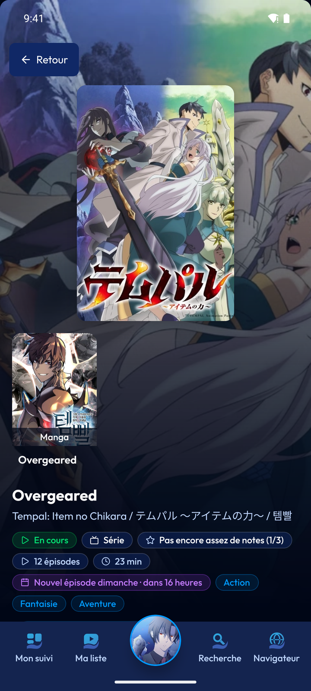

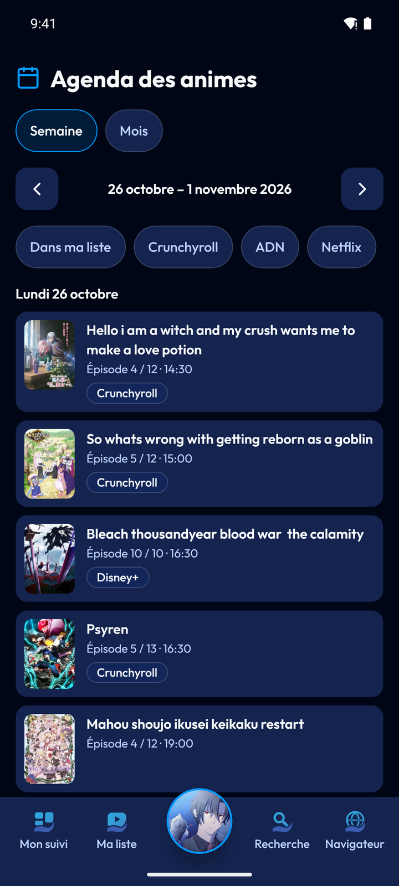
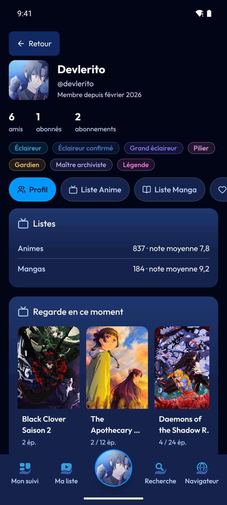

</div>

## Ce que fait l'application

- **Mon suivi** : ce qui sort aujourd'hui, ce qui est en retard, ce qu'il reste à rattraper, avec un « +1 » pour avancer d'un épisode ou d'un chapitre.
- **Ma liste** : animes et mangas, par statut, avec recherche, tri, filtres et quatre modes d'affichage. Modification rapide d'une entrée (statut, progression, note, dates, notes).
- **Fiches** : synopsis, informations, genres, personnages, staff, musiques, studios, relations entre œuvres, actualités, communauté et amis qui suivent l'œuvre. Chaque personnage, personne, musique et société a sa propre fiche.
- **Agenda** : les sorties de la semaine ou du mois, filtrables (« dans ma liste », plateformes), et les animes de la saison.
- **Profil des membres** : badges, listes, favoris et statistiques, selon ce que chacun laisse voir. Ajouter en ami, bloquer ou signaler un membre depuis son profil.
- **Communauté** : chiffres de la période, œuvres regardées en ce moment, classements, annuaire des membres, contributeurs et paliers, propositions.
- **Notifications** : liste dans l'application et réglages par type ; sur le téléphone, vérification régulière (environ toutes les 15 minutes) ou mode instantané en option, **sans service externe**. Voir [Notifications sur le téléphone](#notifications-sur-le-téléphone).
- **Contribuer** : signaler une fiche, proposer une modification (synopsis, nombre d'épisodes ou de chapitres, statut, dates).
- **Navigateur de lecture** : lis un manga ou regarde un anime sur le site de ton choix ; l'application repère l'œuvre et le chapitre ou l'épisode et met ta liste à jour. Voir [Le navigateur](#le-navigateur).
- **Paramètres** : profil, notifications, confidentialité, amis, blocages, sécurité (mot de passe), appareils connectés et suppression du compte.
- **Mises à jour automatiques** : l'application cherche une nouvelle version au lancement et te propose de l'installer.

Ce qui n'est pas encore dans l'application est grisé avec la mention « Bientôt disponible » : discussions, création d'une fiche, import et export de listes.

<div align="center">

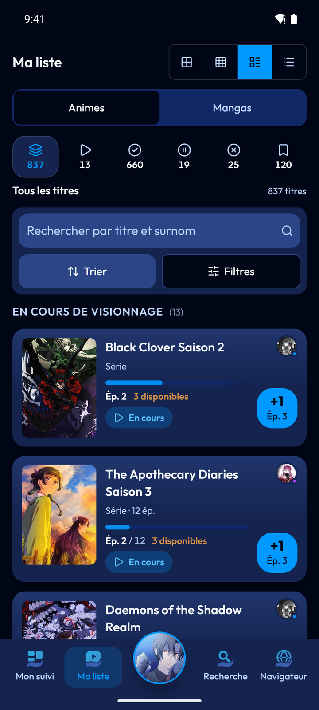
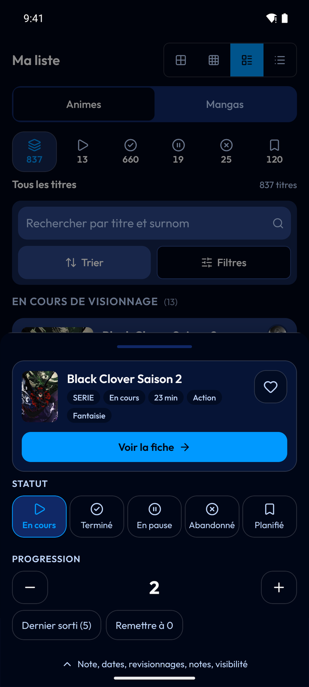
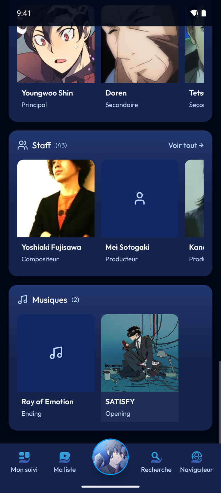
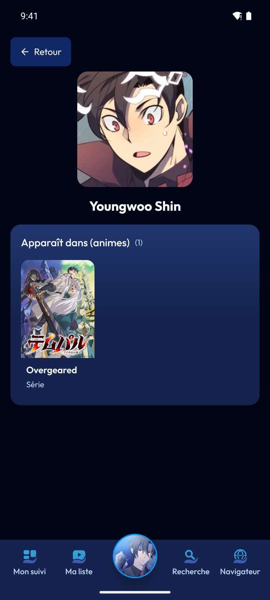
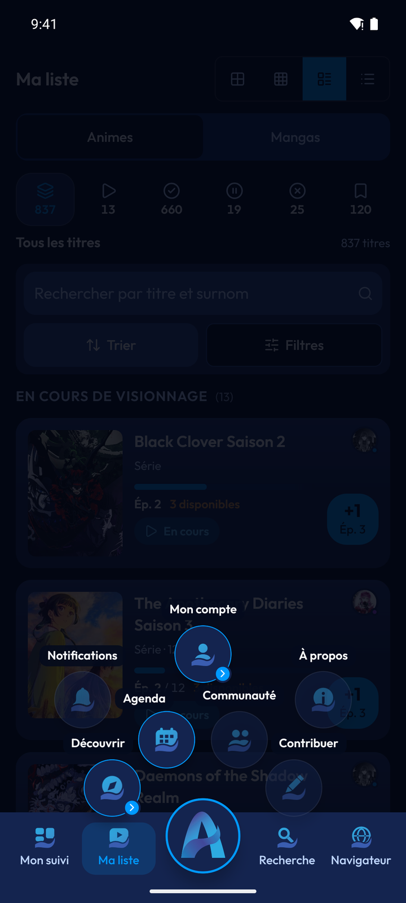
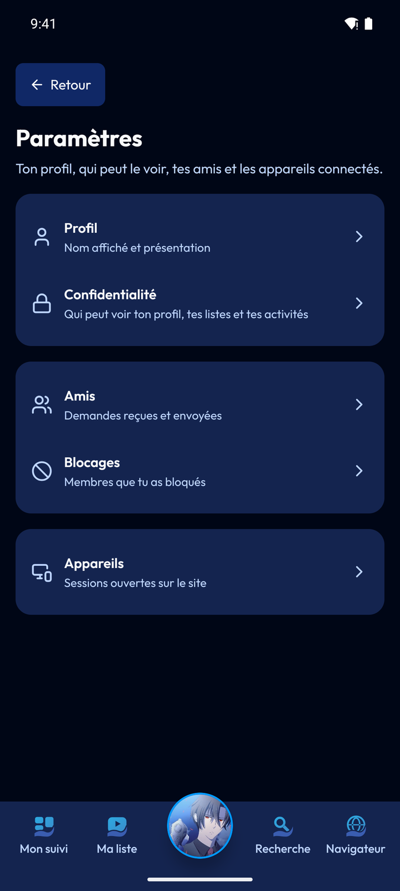

</div>

## Installation

1. Ouvre la page des [releases](https://github.com/Actunime/Actunime-Mobile/releases) depuis ton téléphone Android (7.0 ou plus récent) et télécharge l'APK de la dernière version.
2. Ouvre le fichier. Android te demande d'autoriser l'installation depuis ce navigateur : accepte pour cette fois.
3. Lance Actunime et connecte-toi avec ton compte ([actunime.fr](https://actunime.fr)).

Les versions suivantes se téléchargent toutes seules : au lancement (une fois par jour au plus), l'application lit la dernière release, vérifie l'empreinte SHA-256 de l'APK, puis te propose de l'installer. L'installation dans l'application est facultative : tu peux refuser l'autorisation « installer des applications » et télécharger l'APK à la main sur la page de la release GitHub, qu'un bouton ouvre pour toi. Le réglage se trouve dans **Profil → Mises à jour automatiques**.

## Le navigateur

<div align="center">

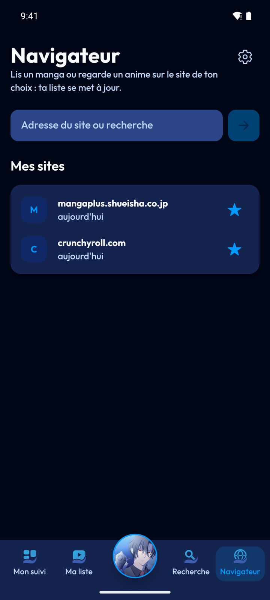


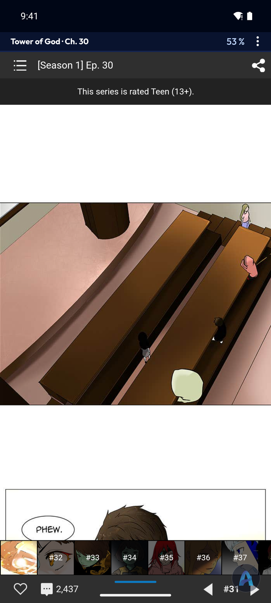
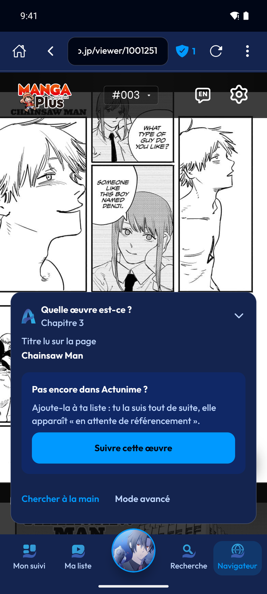

</div>

C'est l'équivalent mobile de l'extension [Actunime Sync](https://github.com/Actunime/Actunime-Sync) : le même cœur de détection, dans un navigateur intégré.

- **Reconnaissance automatique** de l'œuvre, du chapitre ou de l'épisode, avec une pastille discrète qui s'ouvre en panneau quand il faut décider (« Marquer comme lu », « Ce n'est pas la bonne œuvre », « Chercher à la main »). Une œuvre absente du catalogue peut être proposée à l'équipe et suivie tout de suite.
- **Mise à jour de ta liste** à la fin d'un chapitre (défilement) ou d'un épisode (vidéo de la page), ou « ce qui précède » compté quand tu commences la suite. Chaque automatisme se règle ou se coupe dans **Réglages du navigateur**.
- **Lecture confortable** : plein écran quand tu descends dans la page, bande d'état avec l'œuvre et la progression, chapitre ou épisode suivant, historique local effaçable, sites épinglés.
- **Bloqueur de publicités et de traqueurs** intégré (moteur de Brave), avec le compteur de requêtes bloquées.

**Ce que le navigateur ne sait pas faire (pour l'instant)**

- Un lecteur vidéo placé dans une *iframe* d'un autre site n'est pas visible depuis la page : pour ces sites, touche « Marquer comme lu ».
- Sur les lecteurs dessinés sans titre dans la page (MANGA Plus), le titre est repris de la page de la série ouverte juste avant ; ouvrir un chapitre directement par son adresse ne suffit pas.
- Certains sites exigent d'avoir vu leur page de série (cookies) avant d'ouvrir un chapitre.

## Notifications sur le téléphone

Aucun Firebase ni autre service externe : tout passe par ton compte Actunime.

- **Vérifier régulièrement** (activé par défaut) : une tâche Android (WorkManager) interroge l'API environ toutes les 15 minutes, même application fermée. C'est le minimum qu'Android autorise ; l'heure exacte n'est pas garantie.
- **Notifications instantanées** (option, Paramètres → Notifications) : un service au premier plan garde ouverte la même socket que le site (`/notifications`, authentifiée par ton jeton) et affiche chaque notification tout de suite. Android impose alors une icône permanente ; pour que le service survive, exclus Actunime de l'optimisation de batterie (certains constructeurs coupent sinon la connexion).
- Le jeton d'accès est copié côté natif à chaque connexion ou renouvellement ; la partie native ne le renouvelle jamais. Si tu n'ouvres pas l'application pendant plus de 7 jours, les notifications s'arrêtent jusqu'à la prochaine ouverture.
- Sur Android 13 et plus, l'autorisation d'afficher des notifications est demandée depuis Paramètres → Notifications.

## Confidentialité

- Ton jeton de connexion est gardé dans le coffre sécurisé d'Android (`expo-secure-store`). Il se renouvelle tout seul : tu n'as pas à te reconnecter toutes les semaines (révocable depuis Paramètres → appareils connectés).
- L'historique du navigateur, les sites épinglés et la dernière page lue de chaque œuvre restent **uniquement sur ton téléphone** et s'effacent d'un geste.
- Aucun SDK d'analyse d'usage, aucun traqueur publicitaire dans l'application, et aucun service de notification tiers.
- Les listes de filtres du bloqueur de publicités sont téléchargées depuis leurs éditeurs ; elles ne sont pas livrées avec l'application.

Voir aussi [SECURITY.md](SECURITY.md).

## Développer

Prérequis : Node 22, JDK 17, le SDK Android (avec le NDK) et Rust avec `cargo-ndk` pour le moteur de filtres.

```bash
npm install
npm run build:injected          # bundle le script de détection injecté dans les pages
npm run build:rust              # moteur de filtres du bloqueur de pubs (une fois, ou après modification)
npx expo prebuild --platform android
```

Variables d'environnement (lues au build, `EXPO_PUBLIC_*`) :

| Variable | Rôle |
|---|---|
| `EXPO_PUBLIC_API_URL` | API Actunime (par exemple celle de la bêta) |
| `EXPO_PUBLIC_WEB_URL` | site Actunime : page d'autorisation de la connexion |
| `EXPO_PUBLIC_UPDATES_URL` | (facultatif) releases lues par les mises à jour automatiques |

```bash
cd android && ./gradlew assembleRelease     # APK dans android/app/build/outputs/apk/release
```

Vérifications (celles de la CI) :

```bash
npm test             # Vitest : logique, détection, listes, mises à jour…
npm run type-check   # TypeScript strict
```

> Le dossier `android/` est généré par `expo prebuild` et n'est pas versionné. Pour changer une variable `EXPO_PUBLIC_*` d'un build local, supprime `android/app/build/generated/assets/react` avant de relancer Gradle, sinon l'ancien bundle JavaScript est réutilisé.

### Organisation du code

```
src/app/            écrans (Expo Router) : suivi, liste, recherche, fiches, agenda, profils, paramètres, navigateur
src/components/     cartes, listes, navigation du bas et éventail, navigateur, fiches…
src/detection/      script injecté dans les pages et son cœur de détection (copie de celui d'Actunime Sync)
src/lib/            API, requêtes (TanStack Query), logique pure testée : liste, agenda, suivi, détection, mises à jour
modules/            modules natifs Android : actunime-adblock (Rust + Kotlin), actunime-updater (Kotlin)
patches/            correctif de react-native-webview (crochet de filtrage des requêtes)
```

L'application utilise les bibliothèques partagées `@actunime/types`, `validations` et `client` (GitHub Packages, versions exactes figées : après une publication, `npm install @actunime/<lib>@<version>` en `--save-exact`) et parle à l'API par HTTP. L'installation demande un jeton GitHub `read:packages` dans `NODE_AUTH_TOKEN` (secret `NPM_TOKEN` en CI). La connexion suit le flux code + PKCE : l'application ouvre la page d'autorisation du site, puis échange le code contre un jeton renouvelable.

### Versions

Un push sur la branche `beta` lance `.github/workflows/release.yml` : tests, vérification des types, compilation du moteur de filtres, build de l'APK, signature, puis publication d'une release avec une fiche de version (`latest.json` : version, `versionCode`, empreinte SHA-256) que l'application lit pour se mettre à jour.

## Code ouvert, sans contributions

Le code est public **pour la transparence** : tu peux lire ce que fait l'application, la compiler toi-même et vérifier
ce qu'elle garde ou n'envoie pas. Ce n'est pas un projet ouvert aux contributions : les issues et les pull requests ne
sont pas acceptées.

Un problème, un site où la détection se trompe, une idée : écris-nous via la page [Contact](https://actunime.fr/contact)
ou sur le [Discord](https://discord.gg/TJuKYa694n) (donne l'adresse de la page et ce que l'application affiche). Pour une
faille de sécurité, suis [SECURITY.md](SECURITY.md).

## Licence

[MIT](LICENSE). Les composants tiers (moteur de filtres Brave, listes de filtres, bibliothèques) sont listés dans [THIRD_PARTY_NOTICES.md](THIRD_PARTY_NOTICES.md). « Actunime » et son logo appartiennent à leurs auteurs ; les noms de sites cités appartiennent à leurs propriétaires, et Actunime n'est affilié à aucun d'eux.
